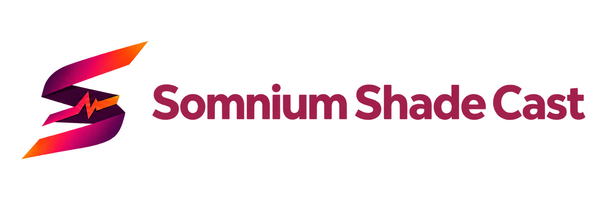

# Somnium Shade Cast

[Русский](README.md) · **English**

<p align="center">
  
</p>

Somnium Shade Cast is a self-hosted server and player for a personal music collection. The project's main goal is a player that selects tracks from the collection to match a listener's mood, using a personal shadow profile.

**Status — first prerelease (MVP).** The project is in active development. The demo client for Windows and Linux already covers the full workflow from upload to playback. Deployment is manual, and the default configuration is intended for local testing. Recommendations, external integrations, and library sharing are on the roadmap.

## What works today

- Uploads of individual audio files or folders with subfolders, with progress and background processing status.
- A browsable, searchable library of tracks, albums, and artists, with embedded cover art extraction and removal from the collection.
- Streaming of the original audio with seeking, a playback queue, and shuffle. The HTTP API can also serve the original file as a download.
- A Go server, a SQLite catalog, encrypted file storage, and a background queue for processing accepted uploads and collecting unreferenced blobs.

## Quick start

1. The server requires the prerelease source code, Docker, and Docker Compose. For a new library, `server/.env` is created from `server/.env.example` with `SSC_MASTER_KEY` set to 32 random bytes encoded in standard Base64. The server guide includes commands for PowerShell and Linux. [Server documentation](server/README.en.md)
2. The following commands start the server from the repository root and check `/health`. The health check uses `curl.exe` on Windows PowerShell.

   ```sh
   docker compose --env-file server/.env up --build --detach --wait
   curl http://127.0.0.1:8080/health
   ```

3. Prebuilt clients for Windows x64 (`.zip`) and Linux x64 (`.tar.gz`) will be available on GitHub Releases in the **Assets** section below the prerelease notes. After extracting the archive and installing dependencies, the client is launched from the extracted directory with `somnium_shade_cast.exe` on Windows or `./somnium_shade_cast` on Linux. A source build is also available. The demo interface is in Russian. [GitHub Releases](https://github.com/DarthanHawke/somnium-shade-cast/releases) · [Client documentation](client/README.en.md)
4. The client connects to the URL entered in the connection field. For a local server with default settings, the prefilled `http://127.0.0.1:8080` can be used. If `SSC_PUBLISH_PORT` has been changed in `server/.env`, the URL uses that port. With the template's `dev` mode enabled, a test profile can be created to upload and play tracks when processing completes.

## How uploads and streaming work

1. **File intake.** The server buffers the upload in memory up to a configured size limit and computes its SHA-256 hash. A matching hash allows reuse of an existing blob. A new blob gets its own file key. Its 128 KiB chunks are encrypted with AES-256-GCM and written to file storage. SQLite stores the blob metadata and the file key wrapped with the server's master key.
2. **Library ingestion.** Once the upload is registered, `POST /ingest/uploads` returns `202 Accepted` and an identifier the client can use to check progress. A background job reads the audio, extracts tags and cover art, and adds the track to the catalog and search index. The track becomes playable once processing succeeds.
3. **Streaming and seeking.** To seek, the player requests a byte range of the original file with HTTP `Range`. The server locates and decrypts the chunks that cover that range and returns the requested bytes with `206 Partial Content`. A request without a range streams the complete original audio without transcoding.

## What encryption protects

Blob encryption protects file contents when only the stored blobs or their backups are exposed and the master key is kept separately. In the MVP, SQLite is stored in plaintext and contains library metadata. Uploads, processing, and streaming all involve plaintext in server memory. A host administrator with access to the process, its memory, or its environment can obtain plaintext or the key. The master key is symmetric and required at every startup. Restoring a library requires its original key.

Planned work includes SQLite encryption and an option to store unencrypted blobs on trusted personal servers. SSH access is a separate concern from encryption at rest. Encryption will remain the preferred storage option for remote hosting.

## Roadmap

- **Mood-based recommendations.** A shadow profile will use tags, listening history, and listening patterns to select tracks from the personal collection.
- **Library enrichment.** External catalogs will expand track, album, and artist metadata. Album pages will show complete track listings, including tracks that have yet to be uploaded. Artist pages will supplement the local collection with discography information.
- **Last.fm.** Scrobbling with a configurable proxy, including for access from Russia. A dedicated tab will show upcoming releases and track suggestions based on the Last.fm profile.
- **Clients and deployment.** Support for more platforms, including Android, and automated server deployment from the client over SSH.
- **Library sharing.** User creation and connection invitations from the client. Each user will have a personal library and access to individual tracks shared by other users.
- **Lyrics.** Viewing, adding, and editing lyrics, fetching versions from external sources, and switching between them.

## License

Somnium Shade Cast is licensed under MIT. Third-party components retain their own licenses. The license for the copy of `dhowden/tag` shipped with the server is kept alongside its sources. [Project license](LICENSE) · [dhowden/tag license](server/third_party/dhowden-tag/LICENSE) · [Client dependencies](client/README.en.md#third-party-components)

